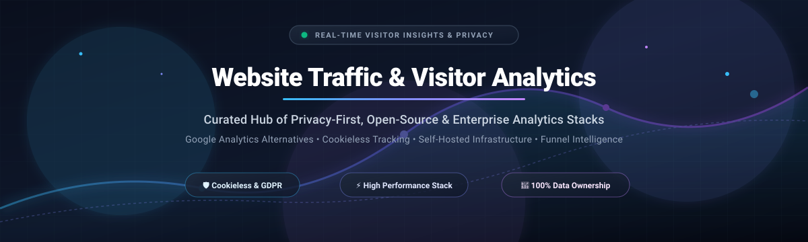
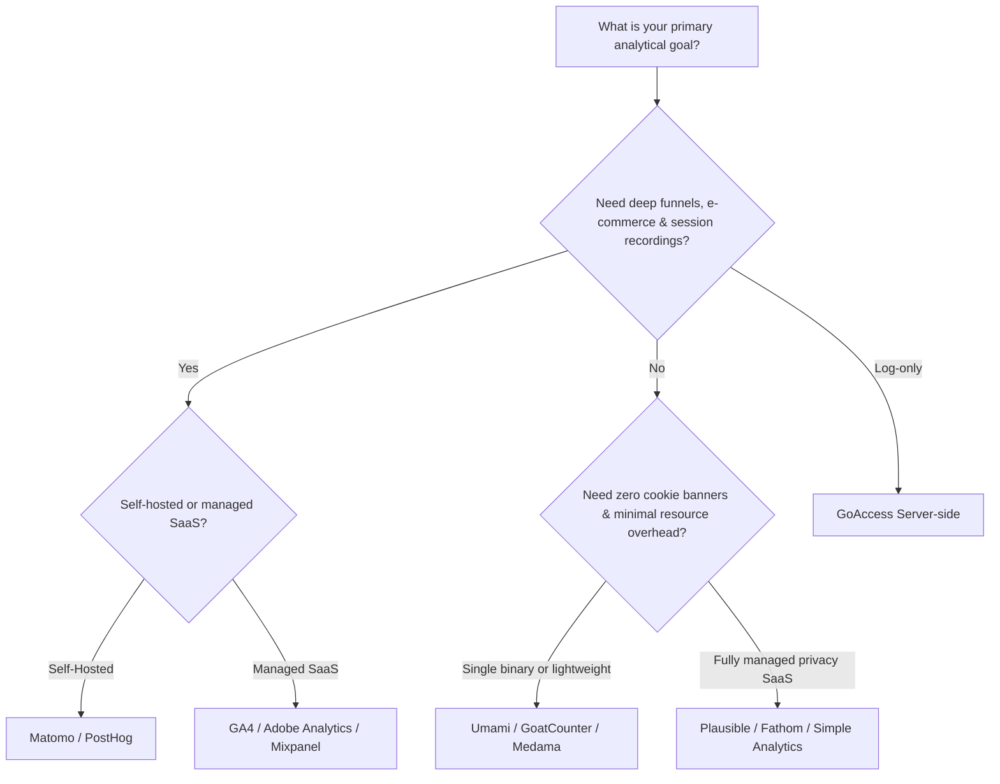

  

# 🌐 Awesome Website Traffic & Visitor Analytics 📊

  
  
  
  
  

> 🎯 **Curated directory of the best Website Traffic & Visitor Analytics platforms, SaaS tools, and open-source self-hosted solutions for tracking visitor journeys, real-time pageviews, conversion funnels, and privacy-compliant web metrics.**

Comprehensive, SEO-optimized guide and curated directory covering enterprise SaaS analytics suites, modern privacy-friendly web analytics, cookieless visitor tracking, and self-hosted open-source Google Analytics alternatives.

*Last updated: October 2026*

---

## 📑 Table of Contents

- [📈 Sector Overview & Market Dynamics](#-sector-overview--market-dynamics)
- [☁️ SaaS & Hosted Web Analytics Platforms](#️-saas--hosted-web-analytics-platforms)
- [💻 Open-Source & Self-Hosted Analytics Projects](#-open-source--self-hosted-analytics-projects)
- [⚙️ Key Architectural & Implementation Trade-Offs](#️-key-architectural--implementation-trade-offs)
- [🧭 How to Choose the Right Analytics Stack](#-how-to-choose-the-right-analytics-stack)
- [⭐ Star History](#-star-history)
- [💖 Support & Sponsorship](#-support--sponsorship)
- [🤝 How to Contribute](#-how-to-contribute)
- [⚖️ Disclaimer & License](#️-disclaimer--license)

---

## 📈 Sector Overview & Market Dynamics

The global web and visitor analytics market is valued between **$7.4 billion and $9.8 billion in 2026** and is projected to surpass **$25 billion to $35 billion by the mid-2030s**, expanding at a compound annual growth rate (CAGR) of **~14% to 17%**. 🚀

The sector exhibits **moderate-to-high concentration at the enterprise apex, alongside extreme fragmentation across modern niche and SME solutions**: Google (via standard GA4 and enterprise GA360) and Adobe command an estimated 55% to 60% of commercial analytics revenue, creating an ubiquitous free baseline for basic metric reporting. Concurrently, heightened regulatory enforcement (GDPR, CCPA, PECR) and deprecation of third-party cookies have driven massive market fragmentation. This has fueled rapid growth for hundreds of independent, privacy-first, cookieless, and open-source alternatives (such as PostHog, Umami, Plausible, Matomo, and Fathom) competing on raw data sovereignty, performance footprint, and un-sampled real-time tracking. 🛡️

---

## ☁️ SaaS & Hosted Web Analytics Platforms

The table below lists leading commercial SaaS and hosted analytics vendors, sorted descending by company scale (market capitalization, enterprise valuation, or annual revenue). 🏢

| Platform | Starting Price (Paid) | Free Tier / Free Trial Limits | Company Scale (Valuation / Revenue) | Description & Key Focus |
| :--- | :--- | :--- | :--- | :--- |
| **[Google Analytics (GA4)](https://analytics.google.com/)** | $50,000/year (GA360 enterprise tier) | Permanent free tier with standard limits: up to 10M events/month, 14-month data retention, standard sampling thresholds | ~$2.1T+ Market Cap (Alphabet Inc.) | The global standard event-based analytics suite deeply integrated with Google Ads, BigQuery, and Search Console. |
| **[Adobe Analytics](https://business.adobe.com/)** | ~$50,000 to $100,000+/year (~$2,000–$4,000+/month base) | No permanent free tier; No self-serve trial (custom enterprise sales demo & sandbox on approval) | ~$220B+ Market Cap (Adobe Inc.) | Enterprise-grade digital intelligence platform offering multichannel attribution, real-time segmentation, and Adobe Experience Cloud integration. |
| **[HubSpot Web Analytics](https://www.hubspot.com/)** | $20/month (Starter tier per seat) | Permanent free tier: Up to 1,000 contacts, 2 users, 10 reporting dashboards with up to 50 pre-built reports each (HubSpot branding required) | ~$30B+ Market Cap (HubSpot Inc., NYSE: HUBS) | Web analytics natively integrated with inbound marketing, CRM records, lead capture forms, and revenue attribution pipelines. |
| **[Mixpanel](https://mixpanel.com/)** | $28/month (Growth tier, billed annually) | Permanent free tier: Up to 1,000,000 events/month, unlimited seats, 10,000 session replays/month, and 1,000 experiment users | $1.05B Valuation ($100M+ ARR) | Advanced product, event, and visitor analytics platform focusing on user journey flows, cohort retention, and conversion funnels. |
| **[Statcounter](https://statcounter.com/)** | $9/month (€9/month for 100k pageviews) | Permanent free tier: Up to 5,000 monthly sessions, 14-day log retention, unlimited websites (displays banner ads on public stats) + 30-day premium trial | ~$15M+ Valuation (~$3M–$5M ARR) | Veteran real-time visitor analytics service providing pageviews, referrers, ISP inspection, and geolocation metrics. |
| **[Clicky](https://clicky.com/)** | $9.99/month (or $79.99/year for Pro tier) | Permanent free tier: 1 website, up to 3,000 daily pageviews, basic stats + 21-day full-access trial for up to 3 sites and 1M daily views | ~$10M+ Valuation (~$1.5M–$3M ARR) | Real-time web analytics providing instant live visitor streams, heatmap tracking, uptime monitoring, and individual session tracking. |
| **[Matomo Cloud](https://matomo.org/)** | €19 to €29/month (~$23–$30/month for 50,000 hits) | 21-day free trial (no credit card required, 100% full feature access including heatmaps, session recording, and funnels; no permanent hosted free plan) | ~$10M–$20M Valuation (InnoCraft) | Fully managed cloud edition of the leading open-source Matomo platform, offering 100% data ownership and EU GDPR compliance. |
| **[Plausible Analytics Cloud](https://plausible.io/)** | $9/month ($90/year for 10,000 monthly pageviews) | 30-day free trial (no credit card required, unlimited sites, full access to business features including funnels & goals; no permanent hosted free plan) | ~$5M–$10M Valuation (~$2M+ ARR, bootstrapped) | Ultra-lightweight (<1KB script), cookie-free, privacy-first hosted analytics hosted on European cloud servers with built-in bot filtering. |
| **[Fathom Analytics](https://usefathom.com/)** | $15/month ($150/year for 100,000 monthly pageviews across 50 sites) | 7-day free trial (requires payment details upfront; no permanent free plan) | ~$5M–$10M Valuation (~$1.5M+ ARR, bootstrapped) | Privacy-centric, cookieless website analytics with EU isolation routing, real-time visitor monitoring, and compliance with GDPR/ePrivacy. |
| **[Simple Analytics](https://simpleanalytics.com/)** | €20/month (Starter tier for 100,000 pageviews) | Permanent free tier: 1 site, 100k pageviews/month, 1-month retention (requires public badge link) + 14-day free trial for commercial tiers | ~$3M–$5M Valuation (~$700k+ ARR, bootstrapped) | Minimalist privacy-first analytics dashboard without tracking cookies or personal data capture, offering AI analytics prompts. |

---

## 💻 Open-Source & Self-Hosted Analytics Projects

The table below lists open-source, privacy-first, and self-hosted website analytics solutions, sorted descending by GitHub Stars_Count. Beside each project name is a social badge linking directly to its repository stargazers page. 🌟

| Repository | GitHub_Stars_Badge | Primary Language / Stack | License | Description & Architectural Focus |
| :--- | :--- | :--- | :--- | :--- |
| **[PostHog](https://github.com/PostHog/posthog)** |  | Python / TypeScript / ClickHouse | MIT (with commercial terms) | All-in-one developer and product analytics platform providing web traffic tracking, session replay, heatmaps, feature flags, A/B testing, and user surveys. Requires 16GB+ RAM for self-hosting. |
| **[Umami](https://github.com/umami-software/umami)** |  | TypeScript / Node.js / PostgreSQL / MySQL | MIT | Extremely popular, lightweight, and modern Google Analytics alternative. Collects privacy-compliant metrics with a tiny 2KB tracker; features session replay, heatmaps, custom boards, and zero AGPL constraints. |
| **[Plausible Analytics](https://github.com/plausible/analytics)** |  | Elixir / Phoenix / ClickHouse | AGPL-3.0 | Simple, cookie-free web analytics with a sub-1KB script. Offers a single-screen dashboard covering pageviews, bounce rates, visit durations, referrers, and campaign conversions. |
| **[Matomo](https://github.com/matomo-org/matomo)** |  | PHP / MySQL / MariaDB | GPL-3.0 | The most comprehensive and mature self-hosted analytics suite. Free forever with unlimited tracking hits, featuring funnels, heatmaps, session recording, tag manager, custom dimensions, and full GA parity. |
| **[GoAccess](https://github.com/allinurl/goaccess)** |  | C / Ncurses | MIT | Fast real-time web log analyzer and interactive viewer. Parses Nginx, Apache, Caddy, and CloudFront logs into terminal TUIs or dynamic HTML reports with zero client-side tracking code. |
| **[OpenPanel](https://github.com/openpanel-dev/openpanel)** |  | TypeScript / Go / ClickHouse | AGPL-3.0 | Self-hostable web and product analytics platform serving as an open-source alternative to Mixpanel and Amplitude with automated event tracking. |
| **[GoatCounter](https://github.com/arp242/goatcounter)** |  | Go / SQLite / PostgreSQL | EUPL-1.2 | Non-intrusive, privacy-focused web analytics that can be deployed as a single standalone Go binary without dependencies. No tracking cookies or GDPR banners required. |
| **[Countly](https://github.com/Countly/countly-server)** |  | JavaScript / Node.js / MongoDB | AGPL-3.0 (Community) | Enterprise-grade, privacy-first analytics and product engagement platform for tracking customer journeys across web, mobile, and IoT devices. |
| **[Ackee](https://github.com/electerious/Ackee)** |  | JavaScript / Node.js / MongoDB | MIT | Node.js-based self-hosted analytics tool for privacy-conscious developers. Generates clean multi-domain overview stats and provides a GraphQL API. |
| **[Plausible Community Edition](https://github.com/plausible/community-edition)** |  | Docker / Elixir / ClickHouse | AGPL-3.0 | Official community-edition distribution repo for self-hosting Plausible Analytics via Docker Compose. Note: Enterprise funnels and e-commerce goals are reserved for the cloud edition. |
| **[Open Web Analytics (OWA)](https://github.com/open-web-analytics/open-web-analytics)** |  | PHP / MySQL | GPL-2.0 | Framework providing WordPress plugins and standalone web tracking with click heatmaps, mouse movement recording, and conversion funnels. |
| **[Aptabase](https://github.com/aptabase/aptabase)** |  | Rust / TypeScript / ClickHouse | AGPL-3.0 (Server) / MIT (SDKs) | Privacy-friendly, cross-platform app and web client event analytics utilizing rotating daily salt hashing to eliminate cross-day user fingerprinting. |
| **[Swetrix](https://github.com/Swetrix/swetrix)** |  | TypeScript / Node.js / ClickHouse | AGPL-3.0 | Fully open-source, cookieless Google Analytics alternative featuring built-in error tracking, performance/Core Web Vitals monitoring, and dark mode dashboards. |
| **[Pirsch](https://github.com/pirsch-analytics/pirsch)** |  | Go / JavaScript | MIT (Core & SDKs) | Cookie-free, lightweight web analytics engine that integrates directly into backend server code or frontend tags with zero visitor fingerprinting. |
| **[Offen Fair Analytics](https://github.com/offen/offen)** |  | Go / JavaScript / Docker | Fair Source 1.0 (Apache 2.0) | Transparent, consent-driven analytics giving operators and visitors equal access to tracked event data. |
| **[Medama](https://github.com/medama-io/medama)** |  | Go / SQLite / DuckDB | Apache-2.0 | High-performance, single-binary, privacy-first web analytics built with Go and DuckDB for ultra-low resource usage and instantaneous queries. |

---

## ⚙️ Key Architectural & Implementation Trade-Offs

When deploying website traffic and visitor analytics, teams typically balance three architectural paradigms: 🔍

1. **Client-Side JavaScript Trackers vs. Server Log Analysis:** 🌐
   - **Client-Side (Plausible, Umami, Matomo, GA4):** Collects client resolution, clicks, single-page application (SPA) route changes, and scroll depth. Prone to ad-blocker filtering unless proxied through first-party domains.
   - **Log Analyzers (GoAccess):** Analyzes raw Nginx, Apache, or CDN access logs on the server. Zero script performance overhead and immune to client ad blockers, but cannot detect client-side interactions or accurately distinguish bots without fine-tuned filters.

2. **Database Engine & Hardware Footprint:** 💾
   - **Relational Databases (SQLite / PostgreSQL / MySQL - Umami, GoatCounter, Medama):** Lightweight (~64MB–256MB RAM) and ideal for personal websites, small businesses, and side projects.
   - **Columnar Databases (ClickHouse - Plausible, PostHog, Swetrix):** Blazing-fast aggregations on billions of rows and high concurrent query speeds, but requires higher memory baselines (2GB–16GB+ RAM) and multi-container orchestration.

3. **Privacy Compliance (GDPR / CCPA / PECR):** 🔐
   - Traditional platforms use cookies and persistent identifiers requiring consent banners.
   - Cookieless analytics platforms (Umami, Plausible, Fathom, GoatCounter) use rotating cryptographic daily hashes or anonymous headers to record unique pageviews without collecting PII, eliminating cookie consent banners.

---

## 🧭 How to Choose the Right Analytics Stack

---

## ⭐ Star History

---

## 💖 Support & Sponsorship

Thank you for exploring this curated repository! If you find this directory valuable for your research, team, or web projects, please consider supporting the project:

- 🌟 **Star the repository** to help others discover it.
- 🍴 **Fork the repo** and contribute updates or new analytics tools.
- 📢 **Share** with colleagues, dev communities, and privacy advocates.
- ☕ **Buy a coffee & sponsor ongoing maintenance:** Support future updates via the [GitHub Sponsor Dashboard](https://github.com/sponsors/ishandutta2007).

Your support keeps this ecosystem directory up-to-date and actively maintained! 🙌

---

## 🤝 How to Contribute

1. 🍴 Fork the repository.
2. 📝 Add your SaaS product or open-source repository following the table formatting conventions.
3. 💵 For SaaS products: Provide verified starting tier pricing, free limits, and valuation/revenue indicators.
4. 🌟 For Open-Source repositories: Ensure the GitHub_Stars_Badge links directly to `/stargazers` and list the repo in descending star order.
5. 🚀 Submit a descriptive Pull Request!

---

## ⚖️ Disclaimer & License

- 📖 This list is community-curated for informational purposes.
- 🏷️ Product logos, trademarks, and registered company names belong to their respective owners.
- 📜 Open-source tools are licensed under their respective repository licenses (MIT, AGPL-3.0, GPL-3.0, Apache-2.0, EUPL-1.2).
- 📄 Contents of this repository are distributed under the [MIT License](LICENSE).
